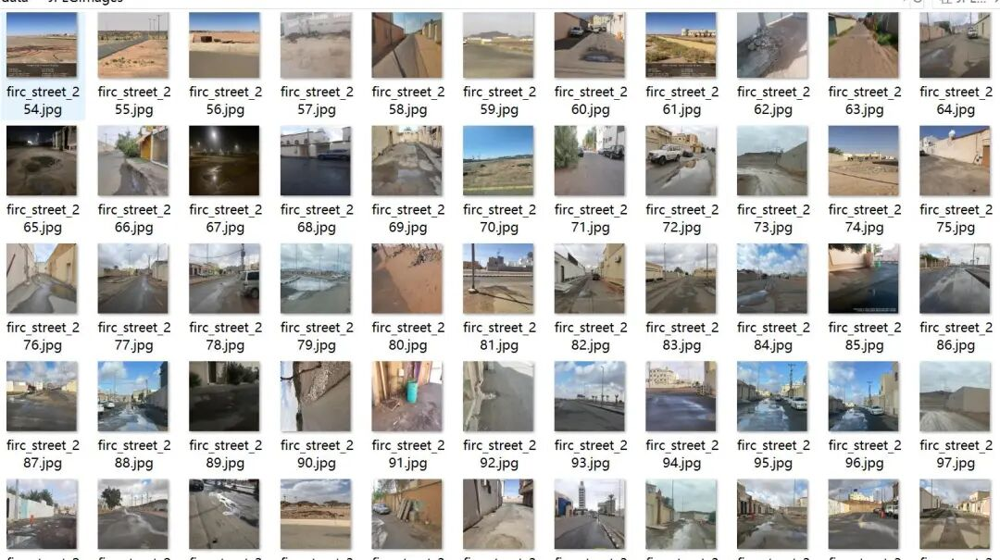
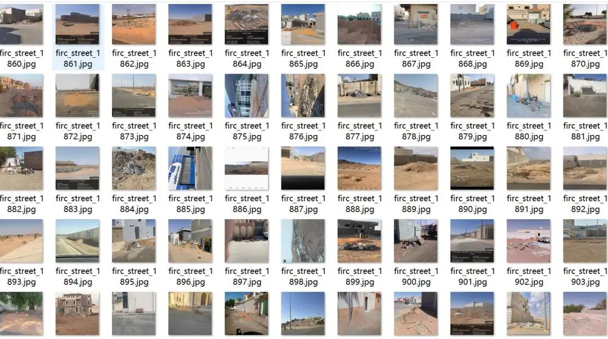
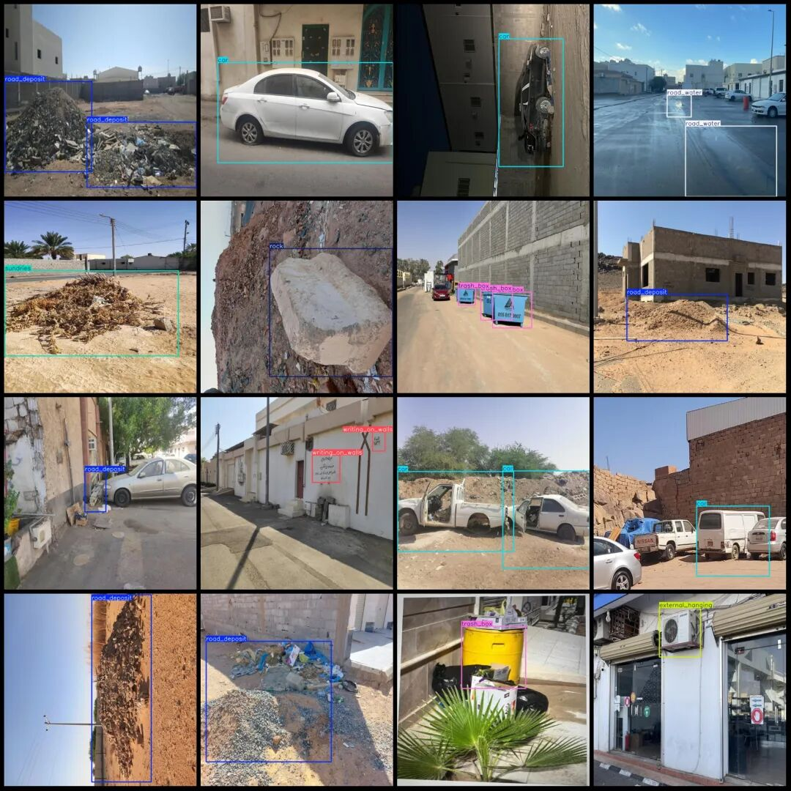

# Smart City - Street Inspection Data for Abnormal Road Conditions and Street Maintenance Junk Detection in VOC+YOLO Format with 3623 Images across 11 Categories

Dataset format: Pascal VOC format + YOLO format (txt file without split path, only contains jpg images and corresponding VOC format xml files and yolo format txt files)

Number of images (number of jpg files): 3623

Number of annotations (number of xml files): 3623

Number of annotations (number of txt files): 3623

Labeling category count: 11

Label category names (Note that the order of categories in the YOLO format does not correspond to this, but is based on the classes.txt file in the labels folder): ["car", "external_hanging", "illegal_construction", "road_crack", "road_deposit", "road_water", "roadside_damage", "rock", "sundries", "trash_box", "writing_on_walls"]

Number of boxes labeled in each category:

car (sedan) frame count = 634

External hanging (wall-hanging items, such as air conditioner units) frame count = 413

illegal_construction(Illegal Construction) Frames = 289

road_crack(Road damage) Frame count = 2695

road_deposit(trash) frame count = 1425

road_water(Road water accumulation) frame count = 206

The number of frames containing "roadside_damage" is 198.

rock() Frames = 287

Sundries (stone) frame count = 149

trash_box (garbage bin) frame count = 177

Writing on Walls (Wall Murals) Frame Count = 272

Total frame count: 6745

Using labelImg:

Annotation rules: Draw a rectangle around the category.

Important Notice: No

Image resolution: 640x640

Special : This dataset does not guarantee the accuracy of the trained models or weight files.

Image Preview:

Annotation example:

## Payment

Here is a pay link on Stripe ( https://buy.stripe.com/3cs8yP7sY87d0vu9AB ). Please contact me lonlonago@foxmail.com after funding $89, and I will send you a complete data files , thank you!

